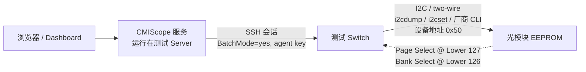
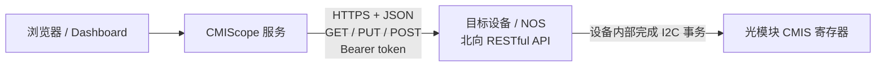

# 使用背景与两种接入方式

> 本文是 CMIScope 的使用背景说明，重点把**两种截然不同的物理接入路径**区分清楚。技术术语保留英文，正文使用中文。

## 1. 为什么需要这个服务

光模块（QSFP-DD / OSFP / QSFP112 / 相干 DCO 等）通过 **CMIS（Common Management Interface Specification，OIF-CMIS-05.3 / 05.4）** 暴露一个 256 字节的分页 EEPROM：低 128 字节常驻，高 128 字节由 Lower Byte 127 的 Page Select 切换。现场遇到的典型问题是：

- 信息分散：设备资产在 CMDB，寄存器读数在交换机 CLI，能力/条款在 OIF PDF，差异在开源驱动里；
- 缺乏统一视图：想看「低页 0x00 的识别信息 + VDM 监控量 + CDB 状态」，要在多个工具间切换；
- 改配置风险高：AppSel、阈值、Tx 均衡、PRBS、固件命令写错会直接打断链路；
- 来源难追溯：某个字段的 byte offset 来自规范原文、第三方解读还是开源实现，往往说不清。

CMIScope 把这些能力收敛成一个**轻量、可移植的本地 Web 工作台**：按设备 / 字段 / 配置项检索，按 CMIS 规范分区展示列表与详情，配置修改前强制校验、修改后给出 diff 与审计反馈，并用知识图谱把字段 ↔ 条款 ↔ 来源 ↔ 开源实现关联起来。服务本身用 Python 标准库 + SQLite 实现，零 pip 依赖、启动快、整目录可迁移。

## 2. 两种接入方式（核心区别）

两种方式描述的是**服务如何触达光模块的 CMIS 寄存器**，不是 UI 的两种皮肤。它们共用同一套字段目录、校验规则、审计日志、CDB 编排逻辑和知识图谱，只在最底层的传输适配器不同。

### 方式一：代码运行在测试 Server，经 SSH 连接测试 Switch，再走 I2C

- **代码位置**：CMIScope 进程跑在**测试 Server**（实验室的一台 Linux/Windows 主机）上。
- **链路**：服务用系统 `ssh` 二进制登录**测试 Switch**，在交换机上执行 `i2cdump` / `i2cset` 或厂商 CLI；真正的两线（I2C）事务由交换机发起，目标是模块 EEPROM 地址 `0x50`（CDB 页同样在 `0x50`）。
- **分页**：读 Upper Page 前必须先写 Lower Byte 127 的 Page Select（Bank 由 Byte 126 选择），并遵守切换后的访问保持时间；多页读完后应恢复原页，避免干扰 Host NOS。
- **凭据**：复用运维人员已有的 ssh-agent 密钥与 `~/.ssh/config`，配置里不保存密码；命令通过 argv 模板渲染（`shlex.split`，不经 shell），占位符做白名单校验。
- **适用场景**：台架调测、模块表征、CMIS 兼容性验证、CDB/固件实验。
- **配置**：`access_mode = ssh-i2c`，并填写 `[ssh]` 段的 `host/user/port/i2c_bus/i2c_addr/*_cmd`。

### 方式二：通过 RESTful API 获取及操作目标设备光模块的 CMIS 信息

- **代码位置**：CMIScope 可以运行在任意能访问北向接口的运维节点上。
- **链路**：服务调用目标设备或 NOS 暴露的 REST 资源（默认占位路径 `/api/cmis/registers`、`/api/cmis/cdb`）；**I2C 由设备侧完成**，服务看到的是规范化后的 CMIS 资源，不直接碰总线。
- **凭据**：Token 从环境变量读取（变量名由 `rest_token_env` 指定，默认 `CMIS_REST_TOKEN`），既不写入 `config.ini`，也不会被 `/api/meta`、`/api/access` 返回。
- **权限模型**：按页级委派，参照 IETF `draft-hi-ccamp-cmis-control-yang-04` 的 `remote-read-allowed-pages` / `remote-write-allowed-pages` / `default-policy`；该草案 §9.1 明确要求 **Lower Memory 写**与 **CDB 页 9Fh–AFh 的远程写**不得被允许，本服务据此默认拒绝。
- **适用场景**：多设备统一运维、自动化、生产系统集成、与控制器/编排系统对接。
- **配置**：`access_mode = rest-api`，填写 `[rest]` 段的 `base_url` 与各路径，并设置 `CMIS_REST_TOKEN` 环境变量。

### 对照表

| 维度 | 方式一 SSH + I2C | 方式二 RESTful API |
|---|---|---|
| 服务运行位置 | 测试 Server | 任意可访问北向 API 的节点 |
| 中间跳板 | 测试 Switch | 目标设备 / NOS |
| I2C 执行者 | 测试 Switch | 目标设备自身 |
| 服务看到的粒度 | 原始 page/byte | 规范化 CMIS 资源 |
| 认证 | ssh-agent 密钥（无密码入库） | 环境变量中的 Bearer token |
| 典型环境 | 实验室 / 台架 | 运维 / 生产 |
| 主要风险 | 直接写寄存器、页选择干扰 Host NOS | 越权页写入、令牌泄露 |
| 安全默认值 | Lower Memory 写禁止；硬件写总开关默认关 | CDB 页默认只读；页级 allowlist 未开启时拒绝写 |
| 适配器类 | `SshI2cAdapter`（`subprocess` + `ssh`） | `RestApiAdapter`（`urllib.request`） |

### 第三种：离线镜像（默认，不是生产接入路径）

`access_mode = mirror`（默认）用于开发、培训、离线评审和 CI。读数来自本地 SQLite，所有配置写入标记为 `staged` 并写入审计日志，`applied_to_hardware` 恒为 `false`。它让整个服务在没有实验室硬件的笔记本上也能完整运行，同时避免误操作真实设备。

### 接入模式与目标设备的可编辑配置

上文的 `config.ini` 描述的是**全局默认接入方式**；实际测试时往往需要按设备切换，或临时新增一台检测设备。为此 CMIScope 额外提供一份可编辑的目标设备清单：

- **配置文件**：`config/targets.json`（首次使用时由 `config/targets.example.json` 提供示例回退；该文件被 `.gitignore` 排除，不随仓库分发）。通用字段为 `device_id`、`access_mode`（`mirror` / `ssh-i2c` / `rest-api`）、`host`、`port`、`module_ids`、`notes`；**模式专属字段严格互斥**：`ssh-i2c` 只能有 `ssh_user/i2c_bus/i2c_addr`，`rest-api` 只能有 `rest_scheme/rest_base_path/token_env`，`mirror` 两者都不允许。同一条目标同时出现两种模式的字段会被拒绝；`active_target` 指定当前测试目标。
- **Dashboard 视图**：左侧「接入配置 / Access targets」可直接切换当前目标、编辑 IP 等必要参数、新增或删除设备、保存并逐个探测。保存后立即生效，无需重启服务。
- **REST 接口**：`GET /api/targets` 读取配置，`PUT /api/targets` 校验并原子写入，`POST /api/targets/probe` 按指定设备探测连通性；`GET /api/access`、`POST /api/access/probe`、`/api/registers/*`、`/api/config-items/*`、`/api/cdb/execute` 都会按 `device_id` 解析该设备自己的传输参数。
- **凭据边界**：目标配置中禁止出现 `token`、`password`、`secret`、`api_key`、`private_key`、`credentials`、`auth` 等字段，写入时会被拒绝并返回 `TARGETS_VALIDATION_FAILED`；REST Token 只能通过 `token_env` 引用环境变量名，SSH 复用 ssh-agent。这样新增设备只需填写 IP/模式等参数，不涉及任何密码入库。
- **逐步操作**见 [`DEPLOYMENT.md`](DEPLOYMENT.md) 与 [`OPERATIONS.md`](OPERATIONS.md)。

## 3. 共同的上层能力

无论选哪种方式，上层完全一致：

1. **检索与展示**：按设备、字段、配置项、图谱实体统一检索；设备列表与详情；字段字典（64 个字段，含中英名称）。
2. **按规范分区的模块 CMIS 视图**：低页 0x00 / VDM / CDB / 控制与诊断，见 [`CMIS_SECTIONS.md`](CMIS_SECTIONS.md)。
3. **配置管理**：查看、编辑、保存前强制校验（类型、枚举、范围、正则、只读位、跨字段约束、待确认告警）、乐观锁、变更 diff、审计反馈、结构化错误处理。
4. **CDB 操作接口**：命令目录、命令帧离线编排与校验码计算、执行入口、状态与操作记录。
5. **知识图谱**：来源标注、置信度、待确认项与双向关联查询。

## 4. 安全策略（两种路径共同遵守）

- `allow_hardware_write` 默认 `false`：不显式开启，任何适配器都不会下发写操作。
- **Lower Memory（0–127）禁止远程写**：含 Host 管理标志与 Page/Bank 选择寄存器，改动会破坏 Host NOS 的模块管理；读取还可能是 Clear-on-Read。
- **CDB 页 9Fh–AFh 禁止纳入远程写白名单**：可触发固件更新并植入持久化恶意固件。
- 固件类 CDB 命令另需 `cdb_allow_firmware=true`；REST 路径执行 CDB 另需 `cdb_rest_allowed=true`；执行必须带确认令牌 `confirm=EXECUTE`。
- 页级写入必须与 Host NOS 协调，避免双方同时管理同一页（IETF 草案 §5、§9.1）。

## 5. 上线前检查清单

- [ ] 确认目标模块 CMIS 版本（5.2 / 5.3 / 5.4）与 `CmisRevision` 字节，按 OIF 原文复核字段偏移。
- [ ] 方式一：确认交换机 CLI 到 I2C bus/mux/端口的映射，改写 `ssh_read_cmd` / `ssh_write_cmd` / `ssh_cdb_cmd` 模板。
- [ ] 方式二：确认北向 API 的认证、字段模型、页级 allowlist 与错误码映射，改写 `[rest]` 路径。
- [ ] 用 `POST /api/access/probe` 与 `GET /api/registers/read` 做只读连通性验证。
- [ ] 逐项复核 `data/knowledge_graph.json` 中 19 条 `pending_confirmations` 后再开启硬件写。
- [ ] 先在离线/热备模块上验证 CDB 命令序列，再考虑固件类命令。
